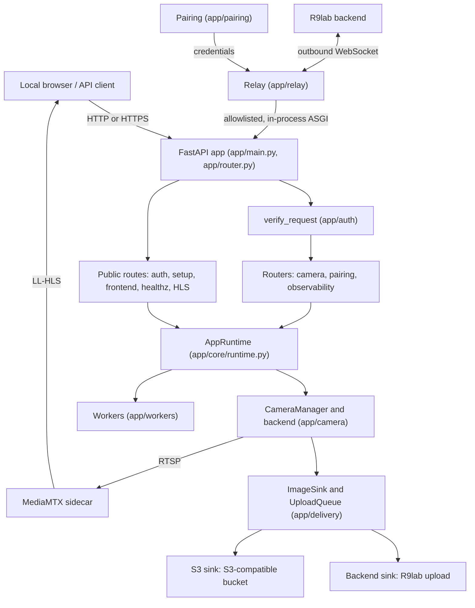

# Architecture

Last reviewed: 2026-11-15

This document is for maintainers and agents changing the plugin internals. Operator setup lives in [INSTALL.md](INSTALL.md); contributor workflow lives in [CONTRIBUTING.md](CONTRIBUTING.md).

The plugin is a FastAPI app running on a Raspberry Pi. It captures images and video, serves local setup and preview surfaces, opens an outbound relay to R9lab, and uploads captures either to the R9lab backend or to S3-compatible storage.

## Request Flow

Feature packages own their routers, schemas, dependencies, exceptions, and services. The camera package also owns the preview/stream pipeline under `app/camera/streaming/`. Cross-cutting packages own infrastructure:

- `app/core`: settings, runtime container, lifespan, bootstrap, middleware, and the frontend router (`frontend_router.py`: `/`, `/favicon.ico`, `/preview-thumbnail.jpg`).
- `app/backend`: the R9lab backend HTTP client (`client.py`), the plugin API path prefix (`plugin_api.py`), and adapters between plugin types and `r9cam_models` DTOs (`contract_adapters.py`).
- `app/relay`: the outbound WebSocket relay, device JWTs, and relay credential checks.
- `app/delivery`: image sinks and the upload queue.
- `app/observability` and `app/workers`: telemetry, logging, tracing, and the long-lived worker loops.
- `app/utils`: file helpers and policy, background task helpers, and local-network checks.
- `app/serve.py`: the process entry point. It starts uvicorn, over HTTPS when `TLS_CERT_FILE` and `TLS_KEY_FILE` are set.

## Runtime Container

`app/core/runtime.py::AppRuntime` is the process container. It owns:

- camera manager
- preview pipeline and media helpers
- relay service and relay state
- pairing service and pairing state
- upload queue worker
- thermal, preview-sleep, and thumbnail workers
- observability handle
- managed background task sets

Code that runs outside a request, such as pairing and relay startup, accesses the active runtime through `app/core/runtime_context.py`.

Architecture rewrites should keep this boundary explicit: `Settings` is static bootstrap input, `RuntimeState` is active mutable credential/auth state, and `AppRuntime` owns long-lived services, workers, and task lifecycles. A service should move into `AppRuntime` only when it is process-owned rather than request-local.

## Lifespan And Bootstrap

Startup is coordinated through `app/core/lifespan.py`, `app/core/bootstrap.py`, and `app/core/settings.py`:

1. Load env-backed `Settings`.
1. At import, `app/main.py` builds the app and calls `ensure_app_runtime`, which creates `AppRuntime` with a `RuntimeState` seeded from settings.
1. In the lifespan, set up logging (`setup_logging`), not at import, so importing the app has no filesystem side effects.
1. `ensure_app_runtime` runs again. It wires the relay to the app and registers the active runtime (`set_active_runtime`), so code outside requests can find it.
1. `bootstrap_runtime_state` checks transport policy, applies persisted relay credentials from `~/.config/r9cam/relay_credentials.json` if static relay credentials are absent, and ensures local and relay-local API keys exist where needed.
1. Log the startup banner and create the image directories (`setup_directory`).
1. Start the relay task when paired, or the pairing task when pairing is configured.
1. Start three recurring tasks: `cleanup_images`, `check_stream_duration`, and `check_stream_health`.
1. Prime the camera (`setup_camera`) and the first preview thumbnail. A missing camera is tolerated, and in development a missing thumbnail is too.
1. Start the workers in this order: thermal governor, preview sleeper, thumbnail worker, upload queue worker.

Shutdown cancels the four runtime workers together (`stop_runtime_workers`) and waits for them. It then cancels the other managed tasks and closes the camera, the backend HTTP client, and the HLS proxy client. Observability shuts down last.

## Configuration And Runtime State

`Settings` is static operator configuration loaded from `.env`. `RuntimeState` stores values that are generated, persisted, or mutable at runtime, such as relay credentials, local API keys, and derived authorized key snapshots. `RelayRuntimeState` is separate and tracks relay connection/activity, not credentials.

Configuration precedence at startup is:

1. env-backed settings
1. persisted runtime credentials
1. generated local defaults

Transport policy is enforced at the settings/runtime boundary. Relay URLs use `wss://` outside `APP_ENV=development`. Remote S3, public URL templates, and OTLP endpoints use HTTPS unless they are loopback or development-only HTTP. Backend-returned media URLs are checked before they reach callers, so uploads do not come back as plain-HTTP links.

`APP_ENV=production` is the fail-closed default. Production rejects `DEBUG=true`, disables Pi-hosted Swagger/OpenAPI routes, blocks HTTP TRACE, and serves only `.css`, `.ico`, `.js`, and `.png`.

## External Connections

Outbound connections are fixed at startup and kept narrow:

- pairing API, relay WebSocket, and upload callbacks go to R9lab
- relay local dispatch is allowlisted first, then gets the relay-local API key
- MediaMTX stays on localhost
- S3 uses HTTPS remotely
- observability collectors are optional

Any path used at request time is either encoded or checked against an allowlist first.

## Cryptography

Relay device assertions are short-lived JWTs signed with the Pi's key: EdDSA for an Ed25519 key (the default) or ES256 for a P-256 key. `DEVICE_KEY_ALGORITHM` picks the type at pairing; after that the stored key's type sets the token's `alg`, so a camera keeps signing with the key it paired with. We validate that key when settings load, credentials are saved, and runtime state is applied, so bad key types fail early.

Relay private keys, relay key IDs, camera IDs, and local API keys live in `~/.config/r9cam/relay_credentials.json` (or the path in `R9CAM_CREDENTIALS_FILE`). The file is written atomically with `0600` permissions. Pairing creates a fresh key pair; unpairing deletes the file.

Session tokens, API keys, pairing fingerprints, JWT IDs, and capture IDs come from Python's `secrets` CSPRNG. API-key comparisons use `hmac.compare_digest`.

## Sensitive Data

Credentials such as relay keys, API keys, session tokens, pairing fingerprints, and S3 secrets stay out of URLs and query strings. API keys and assertions stay in headers or protected response bodies. Logout clears the browser session and drops cached state.

Responses use `Cache-Control: no-store`, static assets come from an explicit extension allowlist, and `/local-key` needs normal auth plus a local-network client.

Logs redact known secret fields, bearer tokens, and private keys before emission. Local pairing banners stay out of JSON logs. Captured images, queue entries, and preview thumbnails are bounded and validated before upload, retry, or serving.

## Auth Boundaries

The plugin has two request-auth modes:

- `X-API-Key` for local direct clients, relay-dispatched local calls, and scriptable integrations
- browser session cookie for the local operator UI

Protected feature routers are included with the shared `verify_request` dependency. Unsafe cookie-authenticated writes require same-origin browser proof through `Origin` or `Referer`; explicit API-key writes do not use that browser CSRF path.

Browser sessions are server-side, in-memory tokens for the local operator UI. Login replaces any existing cookie, sessions expire after 30 minutes of inactivity or 12 hours from creation, and logout or restart clears them.

The plugin does not manage local user accounts, admin roles, MFA, account-disable workflows, or federated identity sessions. Those controls live in the R9lab platform/backend identity boundary. This device plugin only checks local API keys and its own short-lived operator UI sessions.

Local login attempts are rate-limited at the auth boundary. Request schemas own edge validation for camera controls, focus mode consistency, stream keys, upload metadata, and other bounded user-controlled payloads before work reaches services.

The setup page is intentionally public during pairing so headless operators can read the pairing code. Because that code is short-lived, `/setup` and pairing logs should be treated as operator-only during pairing.

Authorization is route based and local to the device. The R9lab backend handles per-user and tenant authorization before sending relay commands; the plugin just keeps the device side narrow:

- unauthenticated routes are `/`, `/setup`, `/pairing/state`, `/favicon.ico`, `/auth/*` (login and logout), `/healthz`, `/preview-thumbnail.jpg`, and `/preview/hls/*`
- `/healthz`, `/preview-thumbnail.jpg`, and `/preview/hls/*` also require a local-network client, and `/setup` hides the pairing code from clients that are neither local nor signed in
- protected routes include camera controls, captures, preview start and stop, streaming, telemetry, metrics, `local-key`, `local-access`, unpair, and pairing-code rotation
- relay-dispatched routes must match the allowlist in `r9cam_models`

Sensitive details stay behind those boundaries. Public setup visitors see bootstrap state only, while authenticated operators can see topology and direct-access details. `/system/local-access` and `/local-key` expose the local API key after `verify_request`, and `/local-key` also requires a local-network client (`is_local_client`).

## Pairing

When relay credentials are absent and `PAIRING_BACKEND_URL` is set, `app/pairing/services/service.py` enters pairing mode:

1. generate a short pairing code and device fingerprint
1. register with the pairing backend
1. display the code on `/setup` and in the `PAIRING READY` log banner
1. poll until the backend claims the code
1. validate returned relay transport
1. persist credentials through `app/pairing/services/credentials.py`
1. start relay operation

Pairing rotation replaces the active code without deleting existing relay credentials.

## Relay

`app/relay/service.py` keeps one outbound WebSocket connection to the paired backend. The backend is a privileged command source for the device. The Pi-side relay limits blast radius with:

- explicit method/path allowlists
- relative path rejection
- filtered inbound headers
- local relay API-key injection before dispatch to FastAPI
- structural command envelope validation plus bounded frame size, queue depth, and command concurrency
- exponential reconnect

New relay-reachable routes should be intentionally added to the allowlist and covered by tests.

The relay allowlist is part of the private backend-to-plugin protocol. It belongs in the shared contract package (`r9cam_models`) with the relay envelopes, not duplicated in plugin runtime code. Breaking relay protocol changes are allowed when they simplify the seam, but they require a shared package version bump and coordinated backend/plugin updates.

## Camera, Preview, And Capture

`app/camera/services/manager.py` coordinates camera operations behind a lock. Hardware access goes through the protocols in `app/camera/services/backend.py`; production uses `Picamera2Backend` (`picamera2_backend.py`), which `manager.py` imports, and tests use fakes. Only `picamera2_backend.py` touches the raw `Picamera2` handle. The preview pipeline (`preview_pipeline.py`) and `stream.py` also import picamera2 encoder and output classes (`H264Encoder`, `FfmpegOutput`) to build the encoder and its RTSP output. They fall back to the stubs in `hardware_stubs.py` where picamera2 is absent.

`CameraBackend` covers the core every camera needs: `is_open` reports hardware readiness and `capture_preview_frame` taps the lores buffer without acquiring the capture lock. `StreamingCameraBackend` adds `start_lores_encoder` / `stop_lores_encoder`, which attach and detach the H264 encoder. `ControllableCameraBackend` adds `get_controls`, `set_controls`, and `set_focus` for runtime camera controls. The preview pipeline narrows to `StreamingCameraBackend` and raises `StreamingNotSupportedError` for a backend without those hooks. Workers and routers call only these protocol methods.

Preview publishes to a local MediaMTX sidecar over RTSP; browsers consume the stream via LL-HLS. Worker-owned hibernation (`PreviewSleeper`) stops the encoder after relay idleness and restarts it on the next HLS request. The `ThermalGovernor` drops the encoder bitrate when the SoC runs hot. The thumbnail worker keeps the setup UI preview current while preview is active.

Remote (relay-proxied) preview deliberately stays on LL-HLS; the rationale and the WebRTC/WHEP migration conditions are recorded in [ADR 0001](docs/adr/0001-preview-streaming-hls-over-relay.md).

Capture requests produce image bytes and bounded metadata, then pass them to the configured `ImageSink`.

`POST /captures` also takes two optional query parameters, which the relay forwards as it does any params: `role=colour_reference` marks the operator's colour-reference shot, and `session_id` sets the session the captures belong to. The manager keeps one current session id (generated at startup, replaced when the operator passes one). Both go into `ImageMetadata` (`capture_role`, `session_id`), so a dataset can pair a session's captures with its reference shot.

With `RAW_CAPTURE=true`, `Picamera2Backend` configures a raw stream and takes the still, its metadata and a DNG from one `capture_request()`, so all three describe the same frame. With it off the pipeline and the still path are unchanged. The manager writes the DNG to `image_path/raw/<capture id>.dng`, removed by `cleanup_images` after `IMAGE_TTL_S`, and records its SHA-256 as `raw_sha256`. The DNG does not travel through the sink or the upload queue: the backend upload takes one `file` part, and a second part is not part of the contract. The operator collects the file from the Pi.

## Image Sinks And Upload Queue

`app/delivery/base.py::ImageSink` abstracts capture persistence:

- backend sink uploads to the paired R9lab backend
- S3 sink uploads to an S3-compatible bucket

`IMAGE_SINK=auto` infers the sink from config. Explicit sink configuration fails loudly when required fields are missing. The upload queue is sink-agnostic: failed synchronous uploads are persisted to disk, retried with exponential backoff, and dead-lettered after exhaustion. Queue capacity and dead-letter retention settings are the single retention policy for failed local captures: `UPLOAD_QUEUE_MAX_PENDING_ENTRIES`, `UPLOAD_QUEUE_MAX_PENDING_BYTES`, and `UPLOAD_QUEUE_DEAD_MAX_ENTRIES`.

Most dead letters come from missing or invalid credentials, so `requeue_dead` moves them back into the live queue with a fresh retry budget. It runs in its own task, so a failure is logged and never breaks pairing or the relay. It runs after pairing completes (first pairing and re-pairing) and after each relay reconnect, but not on the first relay connection at startup. Dead letters left from before a restart wait for the next pairing or reconnect.

Capture IDs and filenames are generated internally. Current captures are `.jpg` / `image/jpeg`, bounded by `MAX_CAPTURE_PIXELS` and `MAX_CAPTURE_FILE_BYTES` before upload or queueing. Persisted queue and thumbnail files are validated before retry or serving. See [Sensitive Data](#sensitive-data) for retention and privacy boundaries.

## Observability

Structured logging is always enabled. Optional components are configured by env:

- Loki-compatible log shipping through the `observability-ship` Compose profile
- OTLP tracing through `OTEL_ENABLED=true` and `OTEL_EXPORTER_OTLP_ENDPOINT`
- local telemetry collection exposed through protected system routes

The log inventory, retention defaults, and access expectations are documented in `INSTALL.md`.

Tracing setup lives in `app/observability/tracing.py`; logging and request-id context live in `app/observability/logging.py` and `app/core/middleware.py`.

## Shared Contract Package

`r9cam_models` contains the backend-to-plugin device DTOs. It validates pairing bootstrap payloads, local access bootstrap data, upload acknowledgements, relay command wire shape, and the shared relay command allowlist. Backend and plugin runtime code enforce that shared policy; frontend code consumes backend OpenAPI rather than importing device DTOs directly.

## Assurance Case

The threat model, trust boundaries and the evidence for each security claim are in
[docs/assurance-case.md](docs/assurance-case.md).
